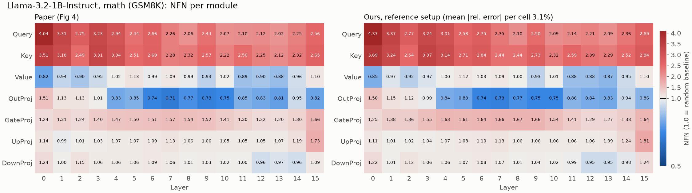
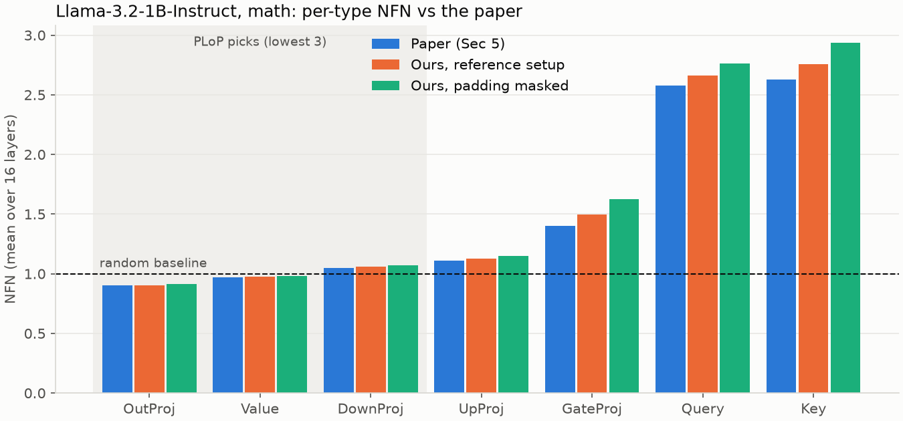
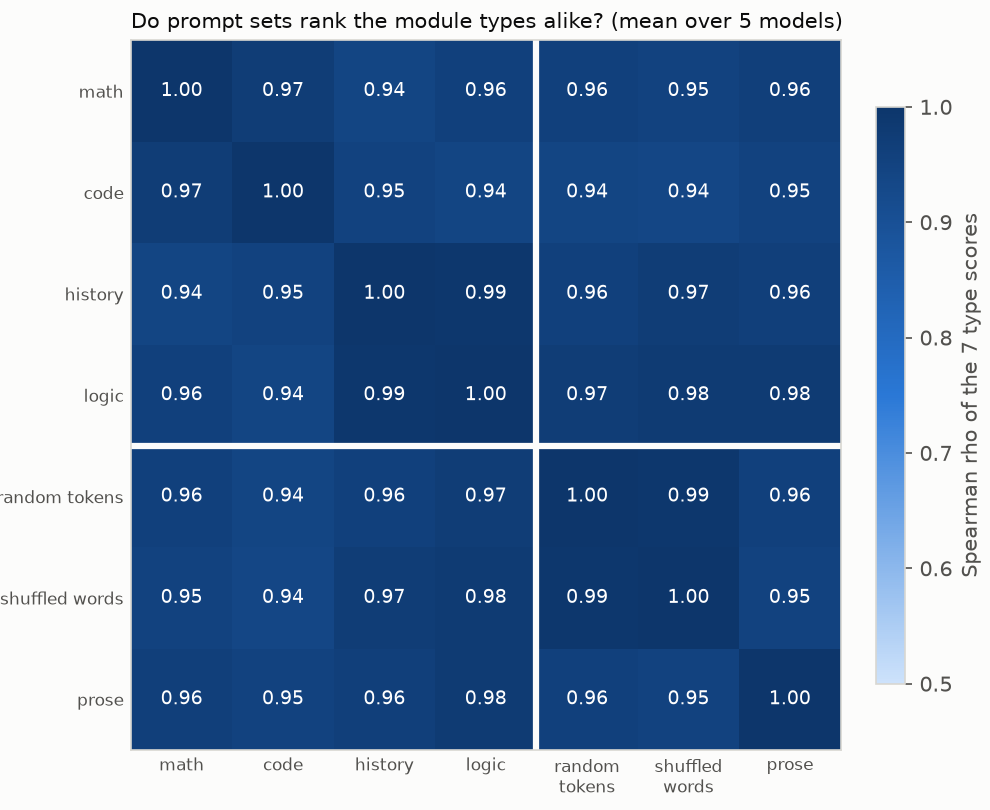

# PLoP Explorer

[](https://github.com/tryzhaa/plop/actions/workflows/ci.yml)

An independent, tested reproduction of **PLoP** ([Hayou, Ghosh & Yu, 2025](https://arxiv.org/abs/2506.20629)), a method that picks which layers of a language model should get LoRA adapters by running one forward pass with no training.



## What PLoP does

When you fine-tune with LoRA you must choose which module types get adapters: attention (Query, Key, Value), the MLP (Gate, Up, Down), or something else. PLoP scores each module by how much more it amplifies real task inputs than random noise of the same size:

```
NFN(W, x) = ||W z(x)|| / ||W z~(x)||        z~ = Gaussian noise with ||z~|| = ||z||
```

An NFN of 1 means the module treats the task like noise. Above 1 means it is already tuned to the task. PLoP averages the score over layers for each of the 7 module types and puts adapters on the **3 lowest**, where there is the most left to learn.

This repo computes the denominator exactly, as `||W||_F ||z|| / sqrt(d_in)`, instead of sampling noise. It reads `W z` from forward hooks, so scoring costs one forward pass and no extra matrix multiplies.

## What I reproduced

All numbers below come from result files committed in [`reference/ours/`](reference/ours). Each file is stamped with its git hash, library versions, seed, dtype and device. [`tests/test_verified.py`](tests/test_verified.py) asserts every claim in this section.

**Per-type scores, Llama-3.2-1B-Instruct on math** (100 GSM8K prompts, the authors' padding setup, CPU fp32):



| Type | Paper | Ours | Difference | Ours, padding masked |
|---|---|---|---|---|
| Query | 2.579 | 2.664 | +3.3% | 2.763 |
| Key | 2.627 | 2.757 | +5.0% | 2.936 |
| Value | 0.969 | 0.973 | +0.4% | 0.983 |
| OutProj | 0.900 | 0.905 | +0.6% | 0.915 |
| GateProj | 1.401 | 1.499 | +7.0% | 1.625 |
| UpProj | 1.112 | 1.128 | +1.4% | 1.148 |
| DownProj | 1.048 | 1.057 | +0.9% | 1.069 |

- Same ranking and the same PLoP pick (OutProj, Value, DownProj). Mean error is 2.6% per type and 3.1% per cell of the 7 × 16 layer map (heatmap above).
- **What the remaining gap is not:** numeric precision (CPU fp32 matches Apple-GPU fp16 to 0.01). Earlier runs, recorded in [plan Section 3.3 A](docs/plop-implementation-plan.md) but not yet committed as result files, also ruled out prompt sampling (about 0.01 across 5 seeds), per-batch vs pooled averaging, and the pad-token choice. The gap is largest on Key, Gate and Query, and the likeliest cause is the authors' older `transformers` version.

**The paper's selection sets, 5 models** (lowest 3 = PLoP, highest 3 = PLoP^-1):

| Model | Paper's sets | Ours | Matches on |
|---|---|---|---|
| Llama-3.2-1B-Instruct | V, O, Down | V, O, Down | all 4 tasks |
| Qwen2.5-0.5B | V, O, Up | V, O, Up | all 4 tasks |
| Qwen3-0.6B | Down, Up, V / Gate, K, Q | same | all 4 tasks, both sets |
| Qwen3-1.7B | Down, O, V / Gate, K, Q | same on math | math; history and logic swap O for Up, a near-tie (0.95-0.99) |
| Gemma3-1B-it | K, V, Up / O, Gate, Down | same | math, history, logic; code swaps K for Q (1.30 vs 1.28) |

The base model Gemma3-1B-pt misses the highest-3 set on every task, so the paper used the instruct model. Gemma overflows in fp16 and was scored in fp32.

**LoRA parameter counts:** all 16 of the paper's #Params values are reproduced ([`tests/test_lora_params.py`](tests/test_lora_params.py)). This also pins down that the paper's "Attn" placement means Q, K, V without O.

## What the paper gets wrong or leaves unclear

From the full [discrepancy log](docs/plop-implementation-plan.md#8-paper-discrepancy-and-ambiguity-log-keep-in-the-readme):

1. **The closed-form approximation of NFN is off by a factor of sqrt(d_in).** The exact expectation is `||W z|| sqrt(d_in) / (||W||_F ||z||)`.
2. **Theorem 1 and its proof disagree.** The statement gives `Gamma_0 + beta^2 (1 + t(t-1))`; the proof's recursion sums to `Gamma_0 + beta^2 t^2`.
3. **The boxed algorithm squares the norms, but Definition 1 does not.** The authors' code uses unsquared norms.
4. **Batch settings conflict.** The text says batch 200; the command says batch 8 with 100 samples. They give the same result.
5. **Learning rates were tuned on the test set** in the SFT tables. Most PLoP vs MLP gaps there are within the ~1.3-point binomial error of GSM8K's 1,319 test problems.

## A finding of my own: the pick is mostly a property of the model

Is PLoP's choice task-aware? I scored 5 models on the four task prompt sets plus three controls: random tokens, the math prompts' words shuffled, and unrelated prose ([`scripts/x4_task_vs_model.py`](scripts/x4_task_vs_model.py), 100 prompts, padding masked).



- Within a model, every prompt set ranks the 7 module types almost the same way (Spearman ρ 0.94-0.99), **even random tokens vs math (0.96)**. Between models ρ is about 0.5.
- The top-3 pick is identical on all 4 tasks for 4 of 5 models, and the three controls give the same pick as the tasks for the same 4 (Qwen3-1.7B differs where Out and Up are a near-tie).
- Scores do shift with the input (random tokens sit 0.04-0.07 from the task average, against 0.02-0.04 between tasks), so the signal is not zero, but it is small next to the differences between models.
- About 25 prompts were enough for a stable pick on all 3 models I tested; 5-10 on two of them ([X5](docs/img/x5_stability.png)). Base and instruct versions of a model pick the same types in 2 of 3 pairs (X6; Qwen3-0.6B swaps a near-tie).

Limits: one seed, 100 prompts, 7 types, and this does not test whether a task-matched placement trains better. Details in [plan Sections 6.2-6.4](docs/plop-implementation-plan.md).

## What this does not show (yet)

- **No training results.** I have reproduced the scoring and the picks, not the paper's claim that PLoP placements train better. ANLI LoRA runs at matched parameter counts with 3 seeds are next ([plan, Section 14.5](docs/plop-implementation-plan.md)).
- **CPU and Apple GPU only.** The authors used CUDA fp16, and training needs a GPU (Kaggle T4/P100, fp16 instead of the paper's bf16).
- **Planned, not done:** X1, which tests whether the score predicts benefit across all 35 three-type placements. It matters more now, since the pick barely depends on the task.

## Run it

Requires Python 3.10+ (for `transformers>=5`).

```bash
python -m venv .venv && .venv/bin/pip install -r requirements.txt
.venv/bin/python -m pytest -q                                  # 47 tests, CPU, seconds
.venv/bin/python scripts/check_reference.py --task math         # Llama-1B vs the paper, per type and per layer
.venv/bin/python scripts/check_selection.py --device cpu        # 6 models x 4 tasks vs the paper's sets
.venv/bin/python scripts/make_figures.py                        # redraws docs/img from reference/ours
.venv/bin/python scripts/x4_task_vs_model.py && .venv/bin/python scripts/x4_analyze.py   # the controls experiment
```

Models download from Hugging Face. Llama uses the ungated `unsloth` mirror (same weights).

## Layout

| Path | What it is |
|---|---|
| `plop_explorer/nfn.py` | Hook-based NFN scoring, exact baseline, padding mask, per-type and per-layer aggregation, pick |
| `plop_explorer/data.py` | Seeded prompt sets (GSM8K, HumanEval, MMLU history and logical fallacies), as in the authors' code |
| `plop_explorer/lora_params.py` | LoRA parameter counts and equal-budget rank matching |
| `scripts/` | Verification against the paper, and figures |
| `reference/` | The paper's published numbers; `ours/` holds our stamped results |
| `docs/plop-implementation-plan.md` | Status, every experiment, discrepancy log, execution plan |
| `docs/plop-build-spec.md` | Build-ready steps for the remaining work |

## License

MIT
